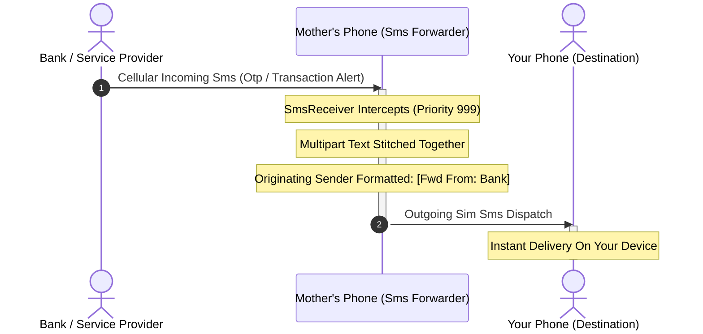

<div align="center">

# Sms Auto Forwarder (Cyber Black And Neon Green Edition)

<p align="center">
  <strong>Ultra-Reliable, Autonomous Sim-To-Sim Sms Forwarding Engine For Otps, Banking Alerts, And Personal Verification Codes</strong>
</p>

[](https://developer.android.com)
[](https://kotlinlang.org)
[-00E676?style=for-the-badge&logo=android&logoColor=080B09)](https://developer.android.com/about/versions/14)
[](#uninterrupted-background-guard)
[](#visual-cockpit-and-responsive-design)
[](https://github.com/suyashchaurasia9-sudo/Sms-Auto-Forwarder/releases/latest)
[](https://github.com/suyashchaurasia9-sudo/Sms-Auto-Forwarder/actions)
[](LICENSE)

<br/>

<a href="https://github.com/suyashchaurasia9-sudo/Sms-Auto-Forwarder/releases/latest/download/app-release.apk">
  
</a>
&nbsp;&nbsp;
<a href="https://github.com/suyashchaurasia9-sudo/Sms-Auto-Forwarder/releases/latest/download/app-debug.apk">
  
</a>


</div>

---

## Executive Overview

Sms Auto Forwarder Is Built Specially For Children, Families, And Remote Account Managers Who Need Instant Access To One-Time Passwords (Otps) And Bank Alerts Delivered To A Far-Away Parent's Phone. It Operates Entirely Offline Through Cellular Carrier Networks, Completely Eliminating The Need For External Web Servers, Cloud Databases, Or Third-Party Subscription Fees.

> [!IMPORTANT]
> **Zero Cloud Dependency**: Every Message Is Forwarded Directly Sim-To-Sim Through The Mother Phone's Existing Sms Plan. No Personal Financial Data Ever Touches The Internet Or External Servers.

---

## Key Capabilities



### 1. Self-Executing Battery Optimization
* **Autonomous Doze Exemption**: The Application Automatically Initiates And Executes Battery Optimization Exemption Itself Upon First Launch, Permission Granting, Or Switch Activation.
* **No Manual Navigation Required**: Automatically Triggers The Native Android Exemption Prompt So The Mother Does Not Need To Dig Through Complex Phone Settings.

### 2. Uninterrupted Background Guard (Runs 24/7 Until Forcefully Closed)
* **Persistent Foreground Service**: Protected By A Low-Priority Silent Status Notification That Prevents Android's Out-Of-Memory Kernel Killer From Terminating The Process.
* **Swipe-Proof Survival (`onTaskRemoved`)**: Even If The Mother Swipes The App Off The Recent Apps Tray, An Immediate `AlarmManager` Hook Auto-Revives The Service Within One Second.
* **Boot Auto-Start (`BootReceiver`)**: Automatically Resumes Forwarding After Device Reboots, Battery Depletion Recharges, Or Os System Updates Without Requiring Anyone To Open The App.
* **Temporary Cpu WakeLock**: Keeps The Cpu Awake During Message Assembly And Dispatch To Guarantee Zero Dropped Messages While The Screen Is Locked.

### 3. Visual Cockpit And Responsive Design
* **Obsidian Amoled Black Palette**: Ultra-Deep Background (`#080B09`) With Glowing Emerald Accents (`#00E676`) For Minimal Eye Strain And Zero Oled Power Waste.
* **280px Responsive Top Bar Spacing**: Tailored End-To-End Responsive Insets Providing Full Bleed Breathing Room Below Status Bars, Camera Punch-Holes, And Curved Cutouts.
* **Concentric Animated Radar Beacon**: A Pulsing Dual-Ring Status Beacon Showing Real-Time Operational State (Active Pulsing Radar Or Standby).
* **Terminal-Style Monospace Log**: Real-Time Feed Showing Sender Badges, Timestamped Records, And Visual Status Indicators.

---

## Architectural File Matrix

All Core Classes Follow Strict PascalCase Conventions:

| PascalCase File Name | Package / Location | Operational Role |
| :--- | :--- | :--- |
| `SmsForwarderApplication.kt` | `com.smsforwarder.app` | Main Application Lifecycle Initialization & Notification Channels |
| `MainActivity.kt` | `com.smsforwarder.app` | Minimal Cockpit, Animated Pulse Beacon, Sim Selector & Live Stream |
| `SmsReceiver.kt` | `com.smsforwarder.app.receiver` | Max Priority Telephony Sms Broadcast Interceptor & Multipart Handler |
| `BootReceiver.kt` | `com.smsforwarder.app.receiver` | Auto-Start Boot Completion Handler & Watchdog Revival |
| `SmsForwarderService.kt` | `com.smsforwarder.app.service` | Unkillable Foreground Service With Task Removal Survival |
| `AppPreferences.kt` | `com.smsforwarder.app.data` | Local Configuration & Serialized Log Storage Management |
| `ForwardLog.kt` | `com.smsforwarder.app.data` | Data Model Representing Forwarded Sms Records |
| `ForwardLogAdapter.kt` | `com.smsforwarder.app.ui` | Recycler View Adapter Rendering Live Stream Records |
| `SmsSender.kt` | `com.smsforwarder.app.util` | Multipart Sms Dispatcher & Sim Subscription Manager |
| `PermissionHelper.kt` | `com.smsforwarder.app.util` | Telephony Runtime Permission Query Utility |
| `BatteryOptimizationHelper.kt` | `com.smsforwarder.app.util` | Doze Mode Exemption & Oem Autostart Settings Launcher |
| `BuildApk.bat` | Root Directory | Automated One-Click Script To Build Debug Apk |
| `BuildApk.yml` | `.github/workflows/` | GitHub Cloud Automated Apk Compiler Workflow |

> [!NOTE]
> Per Android's Official AAPT2 Build System Requirements, Layout And Drawable Filenames Under `app/src/main/res/` Must Remain Lowercase Characters `[a-z0-9_.]` While All Kotlin Source Files And Automation Scripts Follow Strict PascalCase.

---

## How To Build The Apk File

### Method 1: Android Studio (Recommended - 1 Click)
1. Launch **Android Studio** On Your Computer.
2. Select **Open** And Navigate To The Project Directory:
   `c:\Users\suyas\OneDrive\Desktop\SMS-FORWARDER-APP`
3. Allow Gradle Sync To Complete (Takes Approximately 1 Minute).
4. Navigate To The Top Menu Bar:
   **Build** ➔ **Build Bundle(s) / APK(s)** ➔ **Build APK(s)**.
5. Click **Locate** In The Bottom Right Notification To Retrieve The Finished Apk File:
   `app/build/outputs/apk/debug/app-debug.apk`

### Method 2: Automated Script (`BuildApk.bat`)
* If You Have A Java Development Kit (Jdk 17+) Installed, Simply Double-Click [`BuildApk.bat`](BuildApk.bat). The Script Automatically Detects Your Jdk, Invokes The Gradle Wrapper, And Opens The Folder With Your Freshly Compiled Apk.

### Method 3: Cloud Build via GitHub Actions (Zero Local Software Setup)
* This Repository Includes A Pre-Configured Cloud Workflow [`BuildApk.yml`](.github/workflows/BuildApk.yml). Simply Push The Code To GitHub, And GitHub Actions Will Compile The Project In 90 Seconds And Provide A Direct Download Button For `app-debug.apk` Under The **Actions** Tab.

---

## Step-By-Step Setup On Mother's Phone

```text
[Step 1: Install APK] ➔ [Step 2: Enter Phone Number] ➔ [Step 3: Toggle ON] ➔ [Done!]
```

1. **Install The Apk**:
   * Send `app-debug.apk` To Her Phone via WhatsApp, Google Drive, Or Usb Cable.
   * Tap The File And Select **Install Unknown Apps** When Prompted.

2. **Configure Your Number**:
   * Open **Sms Forwarder**.
   * Enter **Your** Mobile Number In The Destination Field (Including Country Code, e.g., `+919876543210`).
   * Tap **Save Configuration**.

3. **Autonomous Battery Optimization**:
   * The App Automatically Prompts Direct Battery Optimization Exemption. Tap **Allow** On The System Dialog.
   * Tap **Grant** Next To *Sms Intercept And Dispatch* To Allow Standard Sms Permissions.

4. **Activate & Test**:
   * Tap **Send Test Sms** To Verify Your Device Immediately Receives The Test Dispatch.
   * Flip The Master Forwarding Switch To **On**. The Neon Green Radar Beacon Will Start Pulsing, And The App Will Guard The Background Uninterrupted 24/7!

---

<details>
<summary><strong>Click Here For Oem Specific Autostart Guidelines (Xiaomi, Samsung, Vivo, Oppo)</strong></summary>

### Xiaomi / Redmi / Poco (Miui / Hyperos)
1. Go To Phone **Settings** ➔ **Apps** ➔ **Manage Apps** ➔ **Sms Forwarder**.
2. Turn On **Autostart**.
3. Under **Battery Saver**, Select **No Restrictions**.

### Samsung (Oneui)
1. Go To Phone **Settings** ➔ **Apps** ➔ **Sms Forwarder** ➔ **Battery**.
2. Choose **Unrestricted**.

### Vivo / Iqoo / Oppo / Realme
1. Go To App Info ➔ Battery ➔ Enable **Allow Background Activity** And **Auto Launch**.
</details>

---

<div align="center">
  <sub>Engineered For Uninterrupted Reliability • Direct Carrier Sim Dispatch • 100% Private</sub>
</div>
